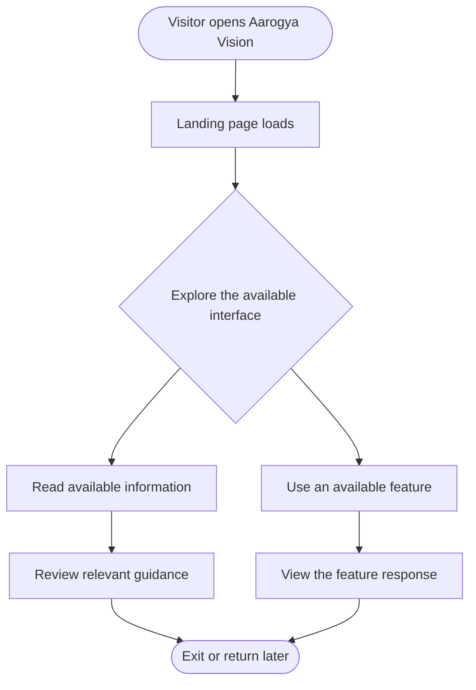
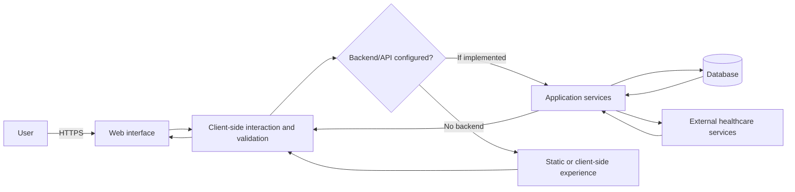
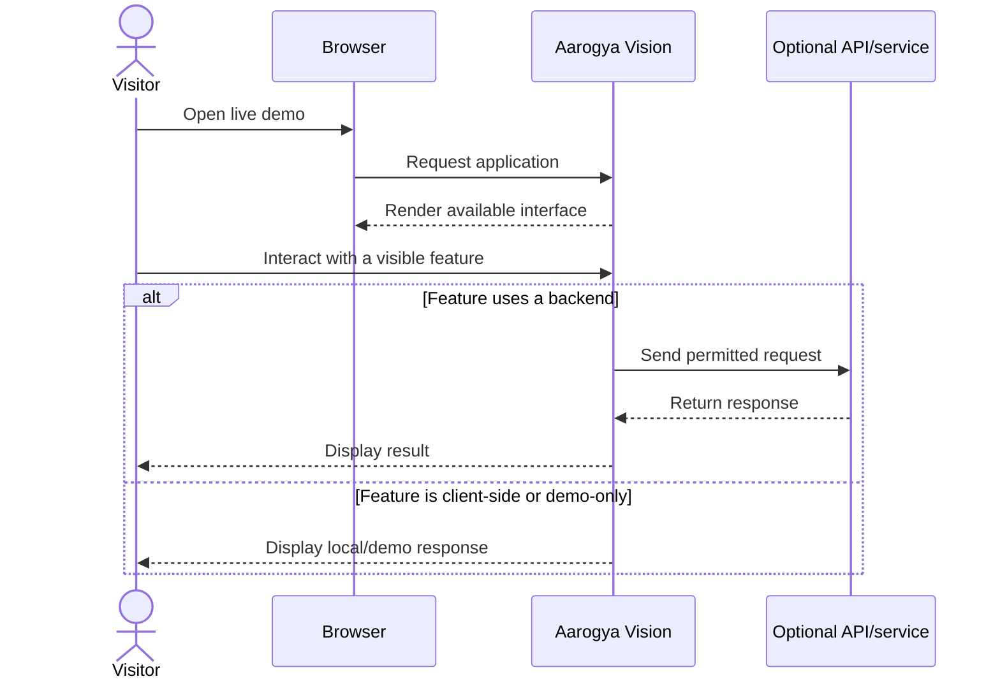

<div align="center">

# 🩺 Aarogya Vision

### A digital-health experience designed to make healthcare information easier to access.

[](https://aarogya-b3uc7sue.manus.space)
[](https://aarogya-b3uc7sue.manus.space)
[](https://aarogya-b3uc7sue.manus.space)

**🔗 Live Demo:** https://aarogya-b3uc7sue.manus.space

</div>

---

## 📌 Table of Contents

- [Overview](#-overview)
- [Project Goals](#-project-goals)
- [Features](#-features)
- [User Journey](#-user-journey)
- [System Architecture](#-system-architecture)
- [Application Flow](#-application-flow)
- [Technology Stack](#-technology-stack)
- [Getting Started](#-getting-started)
- [Project Structure](#-project-structure)
- [Security and Privacy](#-security-and-privacy)
- [Accessibility and UX](#-accessibility-and-ux)
- [Roadmap](#-roadmap)
- [Limitations](#-limitations)
- [Contributing](#-contributing)
- [Disclaimer](#-disclaimer)
- [Contact](#-contact)

---

## 🌿 Overview

**Aarogya Vision** is a digital-health web experience intended to make health-related information and services easier to discover and use. The project is available as a live web demo, so visitors can explore the current interface directly in their browser.

> **Try it now:** [Open the Aarogya Vision live demo](https://aarogya-b3uc7sue.manus.space)

This repository README documents the project at a high level. The public demo was reachable as a deployed page, but its full page content and source code could not be inspected during README preparation. For that reason, implementation-specific details—such as the exact framework, backend, database, authentication provider, and production integrations—are intentionally not guessed. Update those sections when the repository/source configuration is available.

## 🎯 Project Goals

- Present a clear, approachable digital-health experience.
- Make the main user journey easy to understand and navigate.
- Keep the interface readable and usable across common screen sizes.
- Provide a foundation that can be extended with verified healthcare information and appropriate integrations.
- Treat privacy, accessibility, and responsible health communication as essential design considerations.

## ✨ Features

The live demo is the source of truth for the currently available interface. The following are project goals and areas to document; **only mark a capability as implemented after verifying it in the app**.

| Area | Description |
|---|---|
| 🌐 Web access | Open the deployed experience directly in a modern browser. |
| 🧭 User experience | A central interface for exploring the application's available sections. |
| 📱 Responsive design | Intended to support use on desktop and mobile screens; verify on target devices. |
| 🩺 Health-focused content | A health-oriented project direction; confirm the exact content and services in the live build. |
| 🔐 Privacy-conscious design | Privacy and secure handling of any personal information should be requirements for future integrations. |

### Feature checklist for the repository owner

- [ ] Verify and list the exact features currently working in the demo.
- [ ] Add screenshots of the real application.
- [ ] Document any sign-in, forms, dashboards, or other user flows that actually exist.
- [ ] Identify whether data is live, mocked, or stored locally.
- [ ] Document external APIs and integrations, if any.
- [ ] Add accessibility and responsive testing results.

## 🧑‍💻 User Journey

The following Mermaid diagram is a **high-level illustrative journey**, not a claim that every step is already implemented.



## 🏗️ System Architecture

This is a **conceptual architecture for documenting and extending the project**. Replace the illustrative components with the actual implementation once the source code and deployment configuration are available.



**Architecture notes**
- Do not assume a backend or database exists until verified in the source repository.
- Any healthcare API integration should be documented with its purpose, provider, data flow, and failure behavior.
- Never commit API keys, access tokens, patient information, or other secrets.

## 🔄 Application Flow



## 🧰 Technology Stack

The precise stack could not be verified from the deployed page alone. Fill in this table from the actual source code before publishing the repository as a technical project.

| Layer | Technology |
|---|---|
| Frontend framework | React 19
TypeScript 5.9
Vite 7
Tailwind CSS 4 |
| Language | To be confirmed from source |
| Styling/UI library | To be confirmed from source |
| Backend/API | To be confirmed; may not be present |
| Database | To be confirmed; may not be present |
| Hosting | Manus-hosted demo |
| External APIs | To be documented if used |

> **Tip:** Check `package.json`, lock files, environment-variable examples, and deployment configuration to identify the actual tools. Avoid listing technologies that the project does not use.

## 🚀 Getting Started

### Use the live demo

No installation is required to view the deployed version:

➡️ **[Launch Aarogya Vision](https://aarogya-b3uc7sue.manus.space)**

### Run locally

The source repository and its package configuration were not available when this README was prepared, so a reliable install command cannot yet be specified. Once the source code is added to GitHub:

1. Clone the repository.
2. Check the project instructions and package manifest.
3. Install dependencies using the package manager specified by the project.
4. Create a local environment file from a safe example such as `.env.example`, if required.
5. Start the development server using the script defined in the project configuration.

For a JavaScript project, the commands often look like the following, **but use them only if the repository contains a compatible `package.json`**:

```bash
git clone https://github.com/<your-username>/<your-repository>.git
cd <your-repository>
npm install
npm run dev
```

Do not add real credentials to the repository. If environment variables are needed, document their names in `.env.example` with empty or placeholder values.

## 📁 Suggested Project Structure

The actual project structure has not been inspected. Use this only as an example if you are organizing the source code for GitHub.

```text
aarogya-vision/
├── public/                 # Public static assets, if applicable
├── src/                    # Application source, if applicable
│   ├── components/         # Reusable UI components
│   ├── pages/              # Screens or routes
│   ├── services/           # API clients and integrations
│   └── styles/             # Styling and design tokens
├── tests/                  # Automated tests, if configured
├── .env.example            # Placeholder environment variables only
├── .gitignore
├── LICENSE
└── README.md
```

## 🔐 Security and Privacy

Healthcare-related products may handle sensitive information. Before using this project with real users or personal health data:

- Collect only the data that is genuinely necessary.
- Explain what data is collected, why it is collected, and how it is used.
- Use HTTPS in deployment and secure transport for service-to-service communication.
- Keep credentials and private keys in environment variables or a secrets manager.
- Apply server-side authorization and least-privilege access controls wherever a backend exists.
- Avoid logging personal health information or authentication secrets.
- Define retention, deletion, consent, backup, and incident-response procedures.
- Verify applicable privacy, accessibility, and healthcare requirements for the intended region.
- Do not describe the application as compliant, certified, encrypted end-to-end, or production-secure unless that has been independently verified.

## ♿ Accessibility and UX

Recommended checks before a production release:

- Use semantic headings, landmarks, and form labels.
- Ensure keyboard navigation and visible focus indicators.
- Maintain sufficient text/background contrast.
- Provide useful alternative text for meaningful images.
- Make errors understandable and actionable.
- Test responsive layouts on mobile, tablet, and desktop.
- Avoid relying on color alone to communicate important status.

## 🗺️ Roadmap

Potential next steps—select and update these based on the project's real scope:

- [ ] Document the current live-demo features.
- [ ] Add authentic screenshots and a short demo GIF/video.
- [ ] Publish verified setup and deployment instructions.
- [ ] Add automated linting and tests.
- [ ] Add an accessible loading, empty, and error state for each major flow.
- [ ] Document backend/API integrations and data handling.
- [ ] Add a privacy policy and terms where appropriate.
- [ ] Add a contribution guide and choose a license.

## ⚠️ Limitations

- The live demo is provided for exploration; its availability may change.
- The complete source code and implementation configuration were not available during preparation of this README.
- Features, integrations, persistence, and authentication must be verified against the actual application before being represented as implemented.
- A working visual demo does not by itself establish clinical validity, data security, regulatory compliance, or suitability for real patient care.

## 🤝 Contributing

Contributions are welcome once the source repository is available.

1. Fork the repository.
2. Create a feature branch: `git checkout -b feat/your-change`.
3. Make a focused change and test it.
4. Commit with a clear message: `git commit -m "Add: describe your change"`.
5. Push your branch and open a Pull Request describing the change and its testing.

Please do not include real patient data, credentials, private keys, or other confidential information in issues, screenshots, commits, or pull requests.

## 🩺 Disclaimer

Aarogya Vision is presented here as a digital-health project/demo. This README does not establish that the application provides medical advice, diagnosis, treatment, emergency response, or validated clinical recommendations. Users should consult qualified healthcare professionals for medical decisions. In an emergency, contact local emergency services.

## 📬 Contact

- **Live demo:** https://aarogya-b3uc7sue.manus.space
- **GitHub repository:** Add your repository URL after creating it.
- **Maintainer:** Add your name or team name.
- **Issues and suggestions:** Use the GitHub Issues tab once enabled.

---

<div align="center">

**Built with care for a more accessible digital-health experience.**

[🌐 Open Live Demo](https://aarogya-b3uc7sue.manus.space)

</div>
